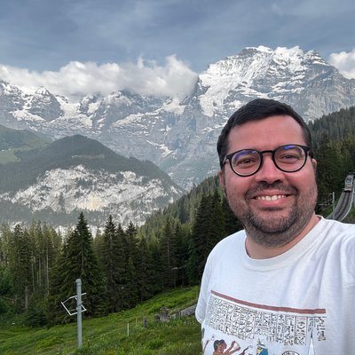

```{r metrics-load}
#| include: false
#| message: false
#| warning: false
m <- tryCatch(yaml::read_yaml("assets/metrics.yml"), error = function(e) NULL)
fmt <- function(x) if (is.null(x) || is.na(x) || identical(x, 0)) "—" else format(x, big.mark = ",")
source("R/metrics.R")
source("R/pubs.R")
```

::: {.cv-page}

::: {.cv-sidebar}

```{=html}

```

<p class="cv-name">Diogo Borges<br>Provete, PhD</p>
<p class="cv-role">Assistant Professor (Tenured)<br>Institute of Biosciences · UFMS</p>

<h3 class="cv-sb-title">Contact</h3>
<ul class="cv-contact">
<li> [diogo.provete@ufms.br](mailto:diogo.provete@ufms.br)</li>
<li> [provetelab.org](https://provetelab.org)</li>
<li><i class="ai ai-orcid"></i> [0000-0002-0097-0651](https://orcid.org/0000-0002-0097-0651)</li>
<li><i class="ai ai-google-scholar"></i> [Google Scholar](https://scholar.google.com.br/citations?user=qDwcLvIAAAAJ)</li>
<li><i class="ai ai-lattes"></i> [Lattes](http://lattes.cnpq.br/9194853434437963)</li>
<li> [diogoprov](https://github.com/diogoprov)</li>
<li> [provete.bsky.social](https://bsky.app/profile/provete.bsky.social)</li>
<li> [iNaturalist](https://www.inaturalist.org/people/1169)</li>
<li> [CalPhotos](https://calphotos.berkeley.edu/cgi/user_query?where-name_full=Diogo+B.+Provete&one=T)</li>
<li> Campo Grande, MS · Brazil — 79002-970</li>
</ul>

<h3 class="cv-sb-title">Personal</h3>
<ul class="cv-meta">
<li>Born in Bom Jesus do Norte, Brazil (1984)</li>
<li>Citizenship: Italian, Brazilian</li>
<li>Married since 2017, with one daughter</li>
</ul>

<h3 class="cv-sb-title">Languages</h3>
<ul class="cv-meta">
<li><strong>Portuguese</strong> — native</li>
<li><strong>English</strong> — proficient (TOEFL, CAE, TOEIC)</li>
<li><strong>Spanish</strong> — good reading / listening / writing; intermediate speaking</li>
<li><strong>Italian</strong> — good listening / reading; basic speaking</li>
<li><strong>German</strong> — A1</li>
</ul>

<h3 class="cv-sb-title">Research interests</h3>
<div class="cv-tags">
<span>Eco-evolutionary dynamics</span>
<span>Macroevolution</span>
<span>Freshwater metacommunities</span>
<span>Geographical ecology</span>
<span>Evolutionary morphology of amphibians</span>
<span>Natural history of Neotropical anurans</span>
</div>

<h3 class="cv-sb-title">Statistics & computing</h3>
<ul class="cv-meta">
<li><strong>Professional Statistician (PStat<sup>&reg;</sup>)</strong> and <strong>Graduate Statistician (GStat<sup>&reg;</sup>)</strong>, American Statistical Association (2026)</li>
<li><strong>R</strong> — advanced. Package and Shiny development, Quarto, git/GitHub, reproducible workflows</li>
<li><strong>Methods:</strong> generalised linear and mixed models; GAM/GAMM; latent-variable and model-based multivariate analysis (GLLVM, HMSC); compositional data analysis; structural equation models; Bayesian inference (Stan/brms); meta-analysis; phylogenetic comparative methods; geometric morphometrics</li>
<li><strong>Also:</strong> Matlab (beginner) · Mesquite · Phylocom</li>
</ul>

<h3 class="cv-sb-title">Memberships</h3>
<ul class="cv-meta cv-meta-compact">
<li>American Society of Naturalists</li>
<li>American Statistical Association</li>
<li>Associação Brasileira de Ciência Ecológica e Conservação</li>
<li>Ecological Society of America</li>
<li>Philosophy of Science Association</li>
<li>Society for the Study of Evolution</li>
<li>International Biogeography Society</li>
<li>SBPC</li>
<li>Sociedade Brasileira de Biologia Evolutiva</li>
<li>Society for the Study of Amphibians and Reptiles</li>
</ul>

:::

::: {.cv-content}

# Diogo Borges Provete, PhD {.cv-headline}

<p class="cv-tagline">Assistant Professor (Tenured) · Institute of Biosciences, Federal University of Mato Grosso do Sul (UFMS)</p>

::: {.cv-actions}
<a class="cv-btn cv-btn-primary" href="assets/cv.pdf" target="_blank">&nbsp;Download&nbsp;PDF</a>
<span class="cv-last-updated">Last updated: `r format(Sys.Date(), '%B %Y')`</span>
:::

::: {.cv-metrics}
<div class="cv-metric"><span class="cv-metric-value">`r fmt(m$scholar$h_index)`</span><span class="cv-metric-label">h-index<br><small>Google Scholar</small></span></div>
<div class="cv-metric"><span class="cv-metric-value">`r fmt(m$scholar$citations_total)`</span><span class="cv-metric-label">Citations<br><small>Google Scholar</small></span></div>
<div class="cv-metric"><span class="cv-metric-value">`r fmt(m$scopus$h_index)`</span><span class="cv-metric-label">h-index<br><small>Scopus</small></span></div>
<div class="cv-metric"><span class="cv-metric-value">`r fmt(m$scopus$citations)`</span><span class="cv-metric-label">Citations<br><small>Scopus</small></span></div>
<p class="cv-metrics-foot">Last successful refresh: Scholar `r metric_success_date(m, "scholar")`; Scopus `r metric_success_date(m, "scopus")`; WoS `r metric_success_date(m, "wos")` · <a href="https://scholar.google.com.br/citations?user=qDwcLvIAAAAJ">Scholar</a> · <a href="https://www.scopus.com/authid/detail.uri?authorId=36142276300">Scopus</a> · <a href="https://www.webofscience.com/wos/author/record/B-3704-2008">WoS</a></p>
:::

## Education

::: {.cv-timeline}
| **2011 – 2015** | **PhD, Ecology and Evolution** — Federal University of Goiás, Brazil. Visiting scholar at the Mathew A. Leibold Lab, University of Texas at Austin.<br>*Phylogenetic structure of metacommunities along environmental gradients.* Advisor: Adriano S. Melo. |
|---|---|
| **2008 – 2010** | **MSc, Animal Biology** — São Paulo State University (UNESP), Brazil.<br>*Resource use and co-occurrence patterns between tadpoles and predaceous insects in sub-tropical assemblages.* Advisors: Itamar A. Martins & Denise C. Rossa-Feres. |
| **2003 – 2006** | **BSc, Biological Sciences** — Federal University of Alfenas (UNIFAL), Brazil. |
:::

## Academic Positions

::: {.cv-timeline}
| **2024 – 2025** | Alexander von Humboldt Research Fellow (Experienced Researchers), Sabbatical at iDiv, Leipzig, Germany |
|---|---|
| **2020 – present** | Assistant Professor (Tenured), Federal University of Mato Grosso do Sul (UFMS) |
| **2017 – 2020** | Assistant Professor, Federal University of Mato Grosso do Sul (UFMS) |
| **2016 – present** | Fellow, Gothenburg Global Biodiversity Centre, Sweden |
| **2016 – 2017** | Postdoctoral Fellow, Federal University of São Carlos, Sorocaba, Brazil. Supervisor: Prof. Fernando R. da Silva |
| **2015** | Postdoctoral Fellow, Department of Biological and Environmental Sciences, University of Gothenburg, Sweden. Supervisor: Prof. Alexandre Antonelli |
:::

## Teaching

### Courses taught

::: {.cv-timeline}
| **UFMS** *(undergrad)* | Biostatistics · Introductory statistics for biologists · General ecology · Ecology of interactions · Ecology of freshwater (lentic) communities · Urban ecology · History and philosophy of science · Introduction to R programming for biologists |
|---|---|
| **UFMS** *(grad)* | Introduction to R · Univariate data analysis (GLM/GLMM) · Multidimensional analyses · Phylogenetic comparative methods · History and philosophy of science · Field ecology |
| **Other institutions** *(grad)* | Biostatistics — UFSCar · Phenotypic evolution & phylogenetic comparative methods — UFSCar, UNESP, UNIFESP · Community ecology — UNESP · Ecological statistics with R — UNESP · Introduction to GLMMs with R — UFPE |
:::

### Student supervision

::: {.cv-timeline}
| **2025 –** | Bruna Maria de Paula Campos · MSc, Animal Biology |
|---|---|
| **2024 –** | Ana Paula Andreazzi · PhD |
| **2023 –** | Daiene L. Hokama Sousa · PhD |
| **2023 – 2025** | Leandro B. Menezes · MSc |
| **2020 – 2025** | Marcos R. Severgnini · PhD |
| **2019 – 2023** | Matheus de Toledo Moroti · PhD |
| **2019 – 2021** | Gabriel Tirintan · MSc |
| **2019 – 2020** | Pedro Abi-Rezik Barros Vianna · MSc, Animal Biology (co-advised) |
| **2018 – 2023** | Philip T. Soares · PhD |
| **2018 – 2023** | Adriana Carolina Acero-Murcia · PhD |
| **2018 – 2020** | Marcos R. Severgnini · MSc |
| **2026 –** | João Victor Santos Barros · Biology undergrad (PIBIC) |
| **2025** | Iara Coimbra · Biology undergrad (PIBIC) |
| **2025** | Beatriz Oliveira · Biology undergrad (PIBIC) |
| **2020** | Laura Bonin · Biology undergrad (honors thesis) |
| **2020** | Hellen Lacerda · Biology undergrad (honors thesis) |
:::

### Doctoral monitoring committees

::: {.cv-timeline}
| **2025 – present** | **Matheus Assis de Oliveira** — PhD, Doctoral School GAIA, Université de Montpellier, France (joint PhD "co-tutelle" with UFPE, Brazil). Research unit MARBEC; directors A. Bertrand & R. Schwamborn. *Functional and taxonomic diversity dynamics of pelagic communities in the Southwestern Tropical Atlantic.* Serving as the statutory **non-specialist member outside the research field** of the Individual Monitoring Committee (CSI). |
|---|---|
:::

### Teaching assistantship for Biology majors

::: {.cv-timeline}
| **2014** | Philosophy of Science — Federal University of Goiás |
|---|---|
| **2011** | Biostatistics — Federal University of Goiás |
| **2009** | Population ecology — São Paulo State University |
| **2006** | Vertebrate Zoology I — Federal University of Alfenas |
| **2005** | Cell Biology — Federal University of Alfenas |
| **2004** | Developmental Biology — Federal University of Alfenas |
:::

## Awards

::: {.cv-timeline}
| **2026** | **SORTEE Commendation Award** — *Análises Ecológicas no R*, with F. R. da Silva, T. Gonçalves-Souza, G. B. Paterno and M. H. Vancine — Society for Open, Reliable, and Transparent Ecology and Evolutionary Biology |
|---|---|
| | **Professional Statistician (PStat<sup>&reg;</sup>)** — American Statistical Association |
| | **Graduate Statistician (GStat<sup>&reg;</sup>)** — American Statistical Association |
| **2024** | Ecological Society of America Early Career Fellow |
| **2021** | Honorable mention, best poster (M. R. Severgnini, PhD student) — I Brazilian Symposium of Comparative Vertebrate Morphology (SIMORF) |
| **2021** | Honorable mention, best oral presentation (A. C. Acero-Murcia, PhD student) — I Brazilian Symposium of Comparative Vertebrate Morphology (SIMORF) |
| **2021** | Honorable mention, best oral presentation (B. O. Martins) — I Brazilian Symposium of Comparative Vertebrate Morphology (SIMORF) |
| **2019** | Best poster (L. Bonin, undergrad) — X Brazilian Congress of Mammalogy |
| **2016** | Sentinels of Science Award — Champions of Recognition (Editors) and top 10% reviewer (Publons) |
| **2016** | 4th best reviewer of the year — Peerage of Science |
| **2013** | Best student paper in Herpetology published in 2012 — Copeia |
| **2012** | Travel award — Association for Tropical Biology and Conservation (USD 500) |
| **2011** | Travel award — South American Chapter of ESA (USD 700) |
| **2010** | Student Travel Award — International Society of Vertebrate Morphology, 9th ICVM (USD 1,000) |
| **2005** | Travel Award — IV Meeting of the South American Group of the Society for Free Radical Biology and Medicine (BRL 300) |
:::

## Publications

::: {.cv-pubs-legend}
Authorship key: <span class="cv-pub-flag">red number</span> = three most important papers · underlined name in PDF = lab graduate student.
:::

### Peer-reviewed journal articles

::: {.cv-pubs}

```{r cv-peer-reviewed-0}
#| echo: false
#| results: asis
pubs_cv(which = "articles", section = "peer_reviewed", numbered = TRUE)
```

:::

### In press

::: {.cv-pubs}

```{r cv-in-press-1}
#| echo: false
#| results: asis
pubs_cv(which = NULL, section = "in_press", numbered = FALSE)
```

:::

### Manuscripts in review

::: {.cv-pubs}

```{r cv-in-review-2}
#| echo: false
#| results: asis
pubs_cv(which = NULL, section = "in_review", numbered = FALSE)
```

:::

### Commentaries, editorials, and magazine papers

::: {.cv-pubs}

```{r cv-peer-reviewed-3}
#| echo: false
#| results: asis
pubs_cv(which = "editorials", section = "peer_reviewed", numbered = TRUE)
```

:::

### Book chapters

::: {.cv-pubs}

```{r cv-book-chapters-4}
#| echo: false
#| results: asis
pubs_cv(which = NULL, section = "book_chapters", numbered = TRUE)
```

:::

### Books

::: {.cv-pubs}

```{r cv-books-5}
#| echo: false
#| results: asis
pubs_cv(which = NULL, section = "books", numbered = FALSE)
```

:::

## Software and intellectual property

### Registered software

::: {.cv-timeline}
| **2026** | **CoDa Stereo: Compositional Data Analysis for Tissue Stereology.** Brazilian National Institute of Industrial Property (INPI), registration **BR512026003293-8**; filed 28 Apr 2026, granted 19 May 2026. Funded by FUNDECT, UFMS and CNPq. |
|---|---|
:::

### Open-source software

::: {.cv-pubs}
**PROVETE, D. B.** 2026. *CoDa Stereo* — Shiny application bringing Aitchison geometry to stereological and histomorphometric data. MIT License. [Live app](https://019dde61-4363-e3fa-b788-13ddfa456c0b.share.connect.posit.cloud) · [Source](https://github.com/diogoprov/CoDaStereo)

**PROVETE, D. B.**; Piatti, L.; Rhinehart, T.; Sugai, L. S. M. 2026. *crywolf* — R package for Bayesian false-positive occupancy models for data from automated detectors. GPL (≥ 3). [Website](https://provetelab.org/crywolf/) · [Source](https://github.com/diogoprov/crywolf)

**PROVETE, D. B.** 2026. *sheepdog* — R package to sample, validate and calibrate BirdNET detections for passive acoustic monitoring. v2.0.0. MIT License. doi:[10.5281/zenodo.22696210](https://doi.org/10.5281/zenodo.22696210) · [Website](https://provetelab.org/sheepdog/) · [Source](https://github.com/diogoprov/sheepdog)

Paterno, G. B.; **PROVETE, D. B.**; da Silva, F. R.; Gonçalves-Souza, T.; Vancine, M. H. 2022. *ecodados* — R package with the datasets and helper functions of the book *Análises Ecológicas no R*. [Source](https://github.com/paternogbc/ecodados)

**PROVETE, D. B.**; Jordani, M. X.; Garey, M. V.; da Silva, F. R. 2012. *Brazilian Tadpoles* — online identification reference for the tadpoles of Brazil. [Website](https://diogoprov.github.io/Brazilian-Tadpoles-5.0/)
:::

### Contributions to scientific infrastructure

::: {.cv-timeline}
| **2016** | Reviewer of amphibian roadkill identifications — Brazilian Wildlife Roadkill Database |
|---|---|
| **2012** | Translator, *ThesBio* — Portuguese synonym thesaurus for the Biodiversity Heritage Library / SciELO |
| **2011** | Contributor, Brazilian Portuguese translation of the **R** statistical environment (R Foundation, Vienna) |
| **2010** | Curator of frogs and toads — **Encyclopedia of Life** |
| **2007** | Taxonomic reviewer for photographic records — [**CalPhotos**](https://calphotos.berkeley.edu/cgi/user_query?where-name_full=Diogo+B.+Provete&one=T), UC Berkeley |
:::

## Selected oral presentations

::: {.cv-pubs}
**Provete, D. B.**; Severgnini, M. R.; Maestri, R. The tempo and mode of tadpole body shape evolution. *2021 Virtual Asilomar conference, American Society of Naturalists*. [video](https://www.youtube.com/watch?v=zxIyjsI3VQw&list=PLrKX8ieTJNbRzXVV2f2e8A2mh1gfmugjX&index=36)

**Provete, D. B.**; Franco-Belussi, L.; Santos, L. R. S.; Zieri, R.; Moresco, R. M.; Almeida, S. C.; Martins, I. A.; Oliveira, C. Phylogenetic signal and diversity of visceral pigmentation in eight anuran families. *2013 Joint Meeting of Ichthyologists and Herpetologists*, Albuquerque, USA.

**Provete, D. B.**; Gonçalves-Souza, T.; Garey, M. V.; Martins, I. A.; Rossa-Feres, D. C. Fine-scale spatial patterns and pond morphology jointly affect metacommunity structure of Neotropical tadpoles. *49th Meeting of the Association for Tropical Biology and Conservation*, 2012, Bonito, Brazil.

**Provete, D. B.** Phylogenies help to uncover diversity patterns in Neotropical amphibians. *49th Meeting of the Association for Tropical Biology and Conservation*, 2012, Bonito, Brazil.

**Provete, D. B.**; Gonçalves-Souza, T.; Martins, I. A.; Rossa-Feres, D. C. Predaceous insects do not influence space use by anuran larvae in ponds: the role of scale and environment. *96th Annual Meeting of the Ecological Society of America*, 2011, Austin, TX.

**Provete, D. B.**; Garey, M. V.; Martins, I. A.; Rossa-Feres, D. C. Abundance patterns and spatial distribution in a metacommunity of tadpoles along a canopy cover gradient. *IX Latin American Congress of Herpetology*, 2011, Curitiba, Brazil.

**Provete, D. B.** Chondrocrania of frog larvae of the genus *Physalaemus* (Anura: Leiuperidae) and their relatives. *9th International Congress of Vertebrate Morphology*, 2010, Punta del Este, Uruguay.
:::

## Professional Services

### Administrative positions

::: {.cv-timeline}
| **2022 – 2026** | Coordinator, Evolution English Language Service (EELS), Society for the Study of Evolution |
|---|---|
| **2024 – 2026** | Council Speaker, Ecological Society of America |
| **2022 – 2026** | Member of the Council, Ecological Society of America |
| **2022 – 2023** | Chair, Latin American and Caribbean Chapter of ESA |
| **2020 – 2021** | Chair, Latin American and Caribbean Chapter of ESA |
| **2019 – 2022** | Graduate Program Director, Animal Biology Graduate Program, UFMS |
:::

### Committees

::: {.cv-timeline}
| **2022 – 2025** | Member, International Committee — Society for the Study of Evolution |
|---|---|
| **2020 – 2022** | Member, Issues in Ecology Committee — Ecological Society of America |
:::

### Grant reviewer panelist

::: {.cv-timeline}
| **2026** | São Paulo Research Foundation (FAPESP), Brazil |
|---|---|
| **2021** | Holsworth Wildlife Research Endowment |
| **2020** | Superintendência de Ciência, Tecnologia e Ensino Superior do Paraná (Brazil) |
| **2018 – 2020** | Society of Systematic Biologists (graduate student research award) |
| **2016** | Amazonas State Research Foundation (Brazil) |
:::

### Journal reviewer

::: {.cv-callout}
Full record: [Web of Science author profile](https://www.webofscience.com/wos/author/record/B-3704-2008).

Acta Herpetologica · American Journal of Botany · American Naturalist · Amphibia-Reptilia · Anatomical Record · Animal Conservation · Asian Herpetology Research · Austral Ecology · Biodiversity Data Journal · Biodiversity and Conservation · Biological Reviews · Biological Journal of the Linnean Society · Biota Neotropica · Biotropica · Botany · Brazilian Journal of Biology · Caldasia · Check List · Chemosphere · Climatic Change · Community Ecology · Communications Biology · Copeia · Current Zoology · Diversity and Distributions · Ecography · Ecology · Ecology and Evolution · Ecological Research · Environmental Entomology · Environmental Management · Ethnobiology and Conservation · Evolution · Forest Ecology and Management · Freshwater Biology · Functional Ecology · Herpetologia Brasileira · Herpetology Notes · Herpetological Conservation and Biology · Herpetological Journal · Herpetologica · Hydrobiologia · Integrative and Comparative Biology · Integrative Zoology · Journal of Animal Ecology · Journal of Avian Biology · Journal of Biogeography · Journal of Evolutionary Biology · Journal of Experimental Biology · Journal of Herpetology · Journal of Mountain Science · Journal of Natural History · Journal for Nature Conservation · Journal of Thermal Biology · Journal of Tropical Ecology · Landscape Ecology · Methods in Ecology and Evolution (Reviewer programme advisor) · Natureza & Conservação · Neotropical Biodiversity · Neotropical Ichthyology · North-Western Journal of Zoology · Oecologia · Oecologia Australis · Oikos · One Earth · Peerage of Science · PeerJ · Perspectives in Ecology and Conservation · PLoS One · Philosophical Transactions of the Royal Society B · Phyllomedusa · Proceedings of the Royal Society B · Restoration Ecology · Revista de Biologia Neotropical · Salamandra · South American Journal of Herpetology · Urban Ecosystems · Web Ecology · Wetlands · ZooKeys · Zoologia · Zoology · Zoomorphology · Zootaxa.
:::

### Guest editor

::: {.cv-timeline}
| **2025** | Special Collection *Waking up on Climate Change: Measuring Impact, Focusing Efforts and Building Futures* |
|---|---|
:::

### Editorial board membership

::: {.cv-timeline}
| **2026 – present** | Deputy Editor — *Global Ecology and Biogeography* |
|---|---|
| **2026 – present** | Assistant Editor — *Global Change Biology* |
| **2023 – 2026** | Associate Editor — *Evolution* |
| **2023 – present** | Senior Editor — *Journal of Biogeography* |
| **2022 – 2026** | Subject Matter Editor — *Frontiers in Ecology and the Environment* |
| **2022 – 2026** | Section then Senior Editor — *Ecology and Evolution* |
| **2021 – 2023** | Associate Editor — *Journal of Biogeography* |
| **2021 – 2022** | Associate Editor — *Ecology and Evolution* |
| **2021 – 2023** | Editor — *Austral Ecology* |
| **2020 – 2023** | Subject Matter Editor — *Ecosphere* |
| **2021 – 2022** | Section Editor (Biodiversity and Conservation) — *PeerJ* |
| **2020 – 2025** | Academic Editor — *PeerJ* |
| **2020** | Academic Editor — *PLoS One* |
| **2020** | Associate Editor — *Herpetological Journal* |
| **2019 – 2026** | Associate Editor — *Journal of Herpetology* |
| **2014 – 2023** | Associate Editor — *Amphibia-Reptilia* |
| **2013 – 2018** | Subject Editor — *Biodiversity Data Journal* |
| **2013 – 2015** | Editor-in-Chief — *Check List* |
| **2013 – 2015** | Subject Editor — *North-Western Journal of Zoology* |
| **2012 – 2014** | Managing Editor — *Herpetology Notes* |
:::

## Research Experience and Technical Skills

- **Field work surveying anuran amphibians:** Serra da Bocaina National Park (Atlantic Rainforest, SP); Salto Morato Private Reserve (Atlantic Rainforest, PR); several localities in NW São Paulo (Atlantic Dry Forest); Lambari State Park (Atlantic Dry Forest, MG); several localities in southern Minas Gerais (Atlantic Dry Forest); Silvânia National Forest (Cerrado, GO); Base de Estudos do Pantanal (Pantanal, MS).
- **Statistics and computing:** Accredited Professional Statistician (PStat®) and Graduate Statistician (GStat®) by the American Statistical Association. Advanced R, including package and Shiny application development, Quarto, and version-controlled reproducible workflows. Applied experience with generalised linear and mixed models, GAM/GAMM, model-based and latent-variable multivariate analysis (GLLVM, HMSC), compositional data analysis, structural equation models, Bayesian inference, meta-analysis, phylogenetic comparative methods and geometric morphometrics. Also Matlab (beginner), Mesquite and Phylocom.
- **Teaching of statistics:** undergraduate and graduate courses since 2016, covering generalised linear mixed models and multivariate methods; course materials are open and version-controlled.
- **Wet-laboratory procedures:** processing biological material for scanning electron microscopy; clearing and staining of vertebrate bone and cartilage tissues.

### Advanced training

Selected short courses and summer schools:

::: {.cv-timeline}
| **2025** | Summer school in statistics for biologists — Université de Sherbrooke, Canada; GLLVMs for advanced multivariate analysis; GAMM and GLMM; meta-analysis in R; probabilistic inference; functional trait diversity |
|---|---|
| **2024** | Path analysis and structural equation modelling; functional trait space analyses; Bayesian phylogenetic inference; model-based statistical inference |
| **2020** | Hierarchical Modelling of Species Communities (HMSC) — University of Helsinki, Finland; multivariate modelling in ecology — University of New South Wales, Australia |
| **2019** | Geometric morphometrics using R — Universidad de Concepción, Chile; mathematical ecology |
| **2017** | Evolutionary Quantitative Genetics — NIMBioS, University of Tennessee, USA; advances in spatial analysis |
:::

## Grants and Fellowships

::: {.cv-timeline}
| **2024 – 2025** | Subsidy towards research costs *(Forschungskostenzuschuss)* — Humboldt Foundation — **EUR 12,000** |
|---|---|
| **2024 – 2027** | Research Productivity grant — FUNDECT-CNPq — **BRL 75,600** |
| **2022 – 2026** | Research grant (Universal) — CNPq — **BRL 99,000** · extended from 2025 to 2026 |
| **Dec 2016 – Aug 2017** | FAPESP postdoctoral fellowship — **BRL 188,212** |
| **Apr 2015 – Oct 2015** | CNPq Science-without-Borders postdoctoral fellowship — **SEK 137,740** |
| **Apr 2011 – Mar 2015** | CAPES-DS PhD fellowship — **BRL 64,800** |
| **Feb 2013 – Dec 2013** | CAPES-PDSE PhD exchange fellowship — **BRL 60,662.64** |
| **Mar 2009 – Feb 2010** | FAPESP Master's fellowship — **BRL 16,481.52** |
| **Sep 2008 – Feb 2009** | CAPES-DS Master's fellowship — **BRL 8,500** |
:::

## Invited symposia and seminars

Slides for several of these are on the [talks page](talks.qmd).

::: {.cv-timeline}
| **2026** | Macroevolution symposium and Editor's round table — Brazilian Society for Evolutionary Biology |
|---|---|
| | *IA na redação científica: ética, regras editoriais e boas práticas de reporte* — annual meeting of the Graduate Programme in Animal Biology, UFMS (Campo Grande), Oct 2026; and UNILA (Foz do Iguaçu), Dec 2026 · [slides](https://provetelab.org/ia-escrita-cientifica/) |
| **2025** | *The other story told by urban ecology in the Global South* — Universität Bielefeld, Germany · [slides](talks/2024-idiv-urban-ecology-global-south.pdf) |
| | *FAIR and CARE peer review and publication* — session "Ecology Is Everywhere, But It Needs to CARE and Be FAIR", Ecological Society of America Annual Meeting, Baltimore, USA, 11 Aug 2025 · [slides](talks/2025-esa-fair-peer-review.pdf) |
| | *Boas práticas para redação e submissão de artigos* — Wiley Customer Education · [slides](talks/2025-wiley-boas-praticas-redacao.pdf) · [video](https://youtu.be/0b4y-8yhjnY) |
| | *Acesso aberto e seus benefícios* — Wiley Customer Education · [slides](talks/2025-wiley-acesso-aberto.pdf) · [video](https://youtu.be/yTz446eXNA0) |
| **2024** | Panelist — "Equity in open access publishing" — Association of Learned and Professional Society Publishers · [slides](talks/2024-alpsp-equity-open-access.pdf) |
| | iDiv Seminar Series — *The other story told by urban ecology in the Global South* · [slides](talks/2024-idiv-urban-ecology-global-south.pdf) |
| | *Evolutionary macroecology of the Atlantic Forest of South America* — Biodiversity, Macroecology and Biogeography group, University of Göttingen, Germany · [slides](talks/2024-gottingen-evolutionary-macroecology.pdf) |
| **2020** | *Eco-evolutionary dynamics in metacommunities* — II Workshop of Community Ecology, IBILCE/UNESP and UFRPE, online · [slides](talks/2020-ii-workshop-eco-evolutionary-dynamics.pdf) |
| **2019** | Short-course on Macroevolution — III Congresso Paulista de Ciências Biológicas, UNESP, São José do Rio Preto |
| **2018** | *Processos neutros e baseados no nicho em comunidades* — Workshop of Community Ecology, UNESP/IBILCE (1st edition, Apr 2018) · [slides](teaching/ecologia-interacoes/slides/08-nicho-teoria-neutra.pdf) |
| **2017** | Seminar series, Department of Environmental Sciences — UFSCar, Sorocaba |
| | *Biogeography and macroevolution of anuran amphibians in the Brazilian Atlantic Forest* — Science Club, Department of Biosciences, Swansea University, UK · [slides](talks/2017-swansea-science-club.pdf) · [announcement](https://swantalks.blogspot.com/2017/04/biosciences-science-club-events-13.html) |
| **2016** | Institute of Biosciences, Letters and Exact Sciences — UNESP, São José do Rio Preto |
| | *Usos e desusos de métodos filogenéticos comparativos* — Seminários Gerais em Biodiversidade Aquática, Institute of Biosciences, Câmpus do Litoral Paulista, UNESP · [slides](talks/2016-unesp-clp-metodos-filogeneticos-comparativos.pdf) |
:::

:::

:::
