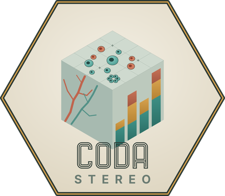
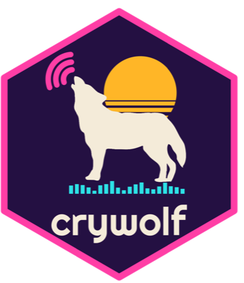

## CoDa Stereo

::: {.callout-tip icon=false appearance="minimal"}
{.hex-sticker}
**Compositional Data Analysis for Stereological, Histomorphometric and Blood-Cell Data**

[ **Launch the live app →**](https://019dde61-4363-e3fa-b788-13ddfa456c0b.share.connect.posit.cloud){.btn .btn-primary} &nbsp;
[ Documentation](https://provetelab.org/CoDaStereo/){.btn .btn-outline-secondary} &nbsp;
[ GitHub repository](https://github.com/diogoprov/CoDaStereo){.btn .btn-outline-secondary} &nbsp;
[ v3.1.0 (Oct 2026)](https://github.com/diogoprov/CoDaStereo/releases){.btn .btn-outline-secondary}

*Free, browser-based — no installation required. Interface in English,
Portuguese and Spanish. Hosted on Posit Connect Cloud · MIT License.*

**Registered software:** Brazilian National Institute of Industrial Property
(INPI), registration no. **BR512026003293-8** — filed 28 April 2026, granted
19 May 2026. Funded by FUNDECT, UFMS and CNPq.
:::

**CoDa Stereo** is an open-source [Shiny](https://shiny.posit.co/)
application that brings the **Aitchison geometry** to the daily workflow
of stereological, histomorphometric and haematological studies — fields where
measurements are naturally **compositional** (proportions of tissue types,
cell-line fractions, leukocyte differentials, organelle volume densities) and
therefore must be analysed with the appropriate log-ratio methods rather than
off-the-shelf parametric tools.

The app implements the full **PPDAC cycle** (Problem → Plan → Data →
Analysis → Conclusion) so that students and collaborators without a strong
statistical background can move from a raw spreadsheet to a defensible
permutational MANOVA with diagnostics, pairwise post-hoc tests, and
publication-ready plots — all in the browser, and in their own language: the
interface and the guided tour are available in **English, Portuguese and
Spanish**.

### What's new in version 3

- **Three languages.** Switch between EN, PT and ES from the header.
- **Reproducibility tab.** Export an R script that reproduces the analysis,
  a self-contained HTML report, or save the session and reload it later.
- **Balances.** An editable sequential binary partition, the CoDa
  dendrogram, and a permutational test of each balance by group.
- **Composition and size.** The log-total can enter the model as a joint
  response or as a covariate (Pawlowsky-Glahn, Egozcue & Lovell 2015), to
  separate changes in composition from changes in size.
- **Richer models.** Numeric covariates (ANCOVA), a block term for nested
  designs, sums of squares of type I, II or III, and pairwise tests of
  dispersion as well as of means.
- **Example data.** The four case studies of the companion paper load from
  the app.
- **Figures.** Every plot exports as PDF, PNG, SVG or TIFF at a chosen size
  and resolution.

Note that clr-biplots now use unscaled clr coordinates, so biplots made with
version 2.x will differ. The full list of changes is in the
[changelog](https://provetelab.org/CoDaStereo/news/index.html).

### Features

| Module | Capabilities |
|--------|--------------|
| **Data upload** | CSV and Excel (`.xlsx`/`.xls`) with sheet selector; the four case-study datasets as examples; aggregation of fields of view into specimens (nested designs); pre-flight check of the selected parts |
| **Data inspection** | Zero/NA heatmap (observed zero vs. structural zero vs. missing); `naniar::vis_miss` plot; counts per part |
| **Zero handling** | Three methods via `zCompositions` (CZM, multRepl, lrEM); NA handling via listwise deletion or geometric-mean imputation |
| **Compositional analysis** | Ternary plot with amalgamation, convex hulls or 95% confidence/predictive regions; clr-biplot with scree plot, ray lengths and optional log-total; variation-matrix heatmap; compositional centre and total variance per group; interactive hover |
| **Balances (SBP)** | Automatic sequential binary partition, editable cell by cell; CoDa dendrogram; boxplots and permutational tests of each balance |
| **Statistical modelling** | Permutational MANOVA via `RRPP::lm.rrpp` with factors, covariates, a block term and SS type I/II/III; log-total as joint response or covariate; pairwise tests of means and dispersions; residual diagnostics |
| **Reproducibility** | R script that reproduces the analysis; self-contained HTML report; save and reload the session (JSON) |
| **Downloads** | Every figure as PDF, PNG, SVG or TIFF; imputed data, SBP, variation matrix, ANOVA, balance and pairwise tables as CSV |

### Why CoDa Stereo

Stereological datasets are routinely analysed as if cell-fraction or
tissue-fraction percentages were independent variables — they're not. The
**unit-sum constraint** induces spurious correlations and false significance
in standard MANOVA. CoDa Stereo handles the geometry correctly throughout,
without requiring users to write log-ratio transforms by hand.

### Use it now (no install)

The recommended way to use CoDa Stereo is to **open it directly in your
browser** — the app is hosted on [Posit Connect Cloud](https://connect.posit.cloud/)
(free tier), so there's nothing to install:

[ **Launch CoDa Stereo**](https://019dde61-4363-e3fa-b788-13ddfa456c0b.share.connect.posit.cloud){.btn .btn-primary}

### Run locally (optional)

If you'd rather run the app on your own machine — useful for sensitive
data, offline work, or customisation — install from GitHub:

```r
# install.packages("devtools")
devtools::install_github("diogoprov/CoDaStereo")
CoDaStereo::run_app()
```

The [package website](https://provetelab.org/CoDaStereo/) has a
getting-started guide, and the [README](https://github.com/diogoprov/CoDaStereo)
explains how to deploy the app to your own Posit Connect Cloud account.

### Citation

CoDa Stereo was developed alongside:

> **Provete, D.B.**, Severgnini, M.R., Fernandes, C.E., Franco-Belussi, L.
> (2026). A practical guide to compositional data analysis in tissue
> stereology and blood cell profile. *Physiological Reports*
> (*in review*).
> [Preprint on Research Square](https://www.researchsquare.com/article/rs-9590298/v1).

The companion paper covers the methodological rationale, simulations
comparing CoDa with naïve approaches, and worked examples.

Please cite both the paper and the software. The software is archived on
Zenodo (doi:[10.5281/zenodo.19928374](https://doi.org/10.5281/zenodo.19928374)),
and BibTeX entries for both are in the
[repository](https://github.com/diogoprov/CoDaStereo#how-to-cite).

::: {.callout-note collapse="true"}
## Registration and licence are two different things

The INPI registration records authorship and the date the source code existed
in a given form — it is the Brazilian equivalent of a software copyright
deposit, and it does **not** restrict use. The app is released under the MIT
licence: you may use, modify and redistribute it, including commercially,
provided the copyright notice is kept.
:::

### Issues, feedback, and contributions

Bug reports, feature requests, and pull requests are very welcome on
[GitHub Issues](https://github.com/diogoprov/CoDaStereo/issues).

## BirdNET Validation Sampler

::: {.callout-tip icon=false appearance="minimal"}
**Sampling and manual-validation pipeline for BirdNET custom classifiers**

[ GitHub repository](https://github.com/diogoprov/birdnet-validation-sampler){.btn .btn-primary}

*R pipeline — MIT License.*
:::

**BirdNET Validation Sampler** turns the raw output of a
[BirdNET](https://birdnet.cornell.edu/) custom classifier into a set of audio
clips that a person can realistically sit down and validate — the step that
decides whether a classifier's detections mean anything in a passive acoustic
monitoring study.

The pipeline selects high-confidence predictions, applies an explicit sampling
design (alternate nights, balanced quotas per species, restricted time
windows), and extracts reproducible `.wav` clips. After the manual review, it
returns precision-by-confidence metrics, suggested confidence thresholds,
presence/absence tables by night, and the clip lists needed to retrain the
classifier.

It was developed for the **FrogNet** project, which monitors frog vocalisations
in the Pantanal and Cerrado, but works with the output of any BirdNET custom
classifier.

## crywolf

::: {.callout-tip icon=false appearance="minimal"}
{.hex-sticker}
**Bayesian false-positive occupancy models for data from automated detectors**

[ Documentation](https://provetelab.org/crywolf/){.btn .btn-primary}
[ GitHub repository](https://github.com/diogoprov/crywolf){.btn .btn-outline-primary}

*R package (models in Stan via cmdstanr) — GPL (≥ 3). Development version.*
:::

**crywolf** fits Bayesian single-season occupancy models that correct for the
false positives produced by automated detectors, such as acoustic classifiers.
It implements the multiple-methods *site-confirmation* design of Miller et al.
(2011), in which a subset of detections is verified and treated as certain,
with the false-positive rate either constant or varying with site covariates.

Besides fitting the models, the package provides simulation tools and
calibration checks — credible-interval coverage and guidance on how many
detections need to be verified — so the design can be evaluated before going
to the field. It pairs naturally with the **BirdNET Validation Sampler** above:
the sampler produces the verified detections, crywolf uses them to correct the
occupancy estimates.

```r
# cmdstanr is distributed through the Stan r-universe
install.packages("cmdstanr", repos = c("https://stan-dev.r-universe.dev", getOption("repos")))
cmdstanr::install_cmdstan()

remotes::install_github("diogoprov/crywolf")
```

To cite the package, use `citation("crywolf")`, together with the paper
describing the model: Miller, D. A., et al. (2011) *Ecology* 92: 1422–1428,
doi:[10.1890/10-1396.1](https://doi.org/10.1890/10-1396.1).

Authors: Diogo B. Provete (maintainer), Liliana Piatti, Tessa Rhinehart and
Larissa Sayuri Moreira Sugai.

## Introdução à Linguagem R — swirl lessons

::: {.callout-tip icon=false appearance="minimal"}
**Interactive lessons in Portuguese for learning R inside the R console**

[ GitHub repository](https://github.com/diogoprov/Introducao_a_Linguagem_R){.btn .btn-primary} &nbsp;
[ The course](https://provetelab.org/intro-r/){.btn .btn-outline-secondary} &nbsp;
[ DOI 10.5281/zenodo.22782697](https://doi.org/10.5281/zenodo.22782697){.btn .btn-outline-secondary}

*swirl course, five lessons — CC BY 4.0 · archived on Zenodo.*
:::

A course for [swirl](https://swirlstats.com), the R package that turns the
console into an interactive tutor: it asks a question, the student types
real R code, and swirl checks the answer and gives a hint when it is wrong.
swirl has a long list of community courses, but until now none written in
Portuguese for ecologists. I have also translated the whole **Regression
Models** course (13 lessons) and three lessons of **R Programming**, and
contributed them as pull requests to the community project
[swirl-Br](https://github.com/paternogbc/cursos_swirl-Br).

The lessons follow the graduate course *Introdução à Linguagem R*
(PPGEC/UFMS) and use the same real, published dataset as the practical
classes: thermal tolerance of Atlantic Forest frogs along two elevational
gradients ([Bovo et al. 2023](https://doi.org/10.1093/iob/obad009)).

| Lesson | Class | Topics |
|--------|-------|--------|
| **Primeiros Passos** | 01 | R as a calculator, assignment, coercion, reading and inspecting data, `table()`, missing values, packages |
| **Curadoria de Dados** | 02 | auditing a deliberately bad spreadsheet and a published file: file naming, header out of place, column types, inconsistent categories, duplicates, date formats, missing-value codes, stored derived columns, site-level variables and metadata |
| **Manuseio de Dados com dplyr** | 04 | the pipe (`\|>` and `%>%`), `rename()`, `select()`, `mutate()`, `filter()`, `group_by()` + `summarise()`, `count()` |
| **Modelos Lineares** | 06 | the PPDAC cycle: sampling design, exploration, `lm()`, diagnostics with `plot()` and `performance`, interpretation with `anova()` and `broom` |
| **Rudimentos de Programação** | 07 | writing functions, default arguments, scope, `if`/`ifelse`/`for`, functional programming with `purrr::map`, one model per species with `split()` + `map()` and `broom` |

Answers are checked by their result, not by how they are written, so both
pipes, `summarise()` or `summarize()`, and arguments in any order are
accepted.

```r
install.packages("swirl")
library(swirl)
select_language("portuguese", append_rprofile = TRUE)
install_course_url("https://github.com/diogoprov/Introducao_a_Linguagem_R/zipball/main")
swirl()
```

## amphiBR

::: {.callout-tip icon=false appearance="minimal"}
{.hex-sticker}
**The official list of Brazilian amphibians as an R dataset**

[ Documentation](https://paulobarros.github.io/amphiBR/){.btn .btn-primary}
[ GitHub repository](https://github.com/paulobarros/amphiBR){.btn .btn-outline-primary}

*R package — GPL (≥ 3). Development version.*
:::

**amphiBR** packages the official List of Brazilian Amphibians published by
the Brazilian Herpetological Society (Segalla et al. 2021,
[Zenodo](https://zenodo.org/record/4716176)) as a single table — 1,188
species — that loads with the package. Each species comes with its taxonomy,
common name, threat category from the Brazilian Ministry of the Environment
assessment (MMA 2022), endemism, and occurrence by state and by biome. It also
flags which species have their tadpoles described, using data from the
[Brazilian Tadpoles](https://diogoprov.github.io/Brazilian-Tadpoles-5.0/)
database: external morphology, internal oral features and chondrocranium.

The goal is to make it quick to build species lists for projects, fauna
inventories and reports.

```r
# install.packages("devtools")
devtools::install_github("paulobarros/amphiBR")
library(amphiBR)
segalla2021
```

Authors: Paulo Barros de Abreu Junior (maintainer), Maurício H. Vancine and
Diogo B. Provete.

## ecodados

::: {.callout-tip icon=false appearance="minimal"}
**Datasets and helper functions for *Análises Ecológicas no R***

[ GitHub repository](https://github.com/paternogbc/ecodados){.btn .btn-primary} &nbsp;
[ The book (free, in Portuguese)](https://analises-ecologicas.com){.btn .btn-outline-secondary}

*R package — community-maintained.*
:::

**ecodados** is the companion R package to
[*Análises Ecológicas no R*](https://analises-ecologicas.com) (da Silva,
Gonçalves-Souza, Paterno, Provete & Vancine, 2022), a 640-page open textbook
that teaches the full workflow of ecological data analysis in R — from data
organisation and visualisation to multivariate analysis, spatial ecology and
phylogenetic comparative methods.

The package ships the datasets used across the book's chapters, so every
example in the text can be reproduced with a single `library(ecodados)`
instead of hunting for files. It is what makes the book runnable rather than
merely readable.

In 2026, *Análises Ecológicas no R* received the **SORTEE Commendation Award** from the
Society for Open, Reliable, and Transparent Ecology and Evolutionary Biology, which
recognises projects that promote open, transparent and reliable research practices in
ecology and evolution.

The book is freely available online and has become a standard reference for
teaching ecological data analysis in Portuguese-speaking universities.

::: {.callout-note}
## Authors

Gustavo B. Paterno, Diogo B. Provete, Fernando R. da Silva, Thiago
Gonçalves-Souza and Maurício H. Vancine.
:::
